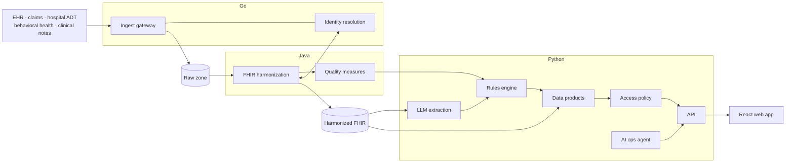

# Clinical Data and AI Platform

A platform that turns clinical, claims and document data into insight for patients, providers and
payers, designed for Google Cloud and built to be developed and operated with AI agents under
enterprise controls.

This repository is a working vertical slice: synthetic data flows through every layer on a laptop,
and Terraform describes the Google Cloud deployment. It is a reference implementation, not a
production system. **All data is synthetic.** No real patient information belongs here.



## What it does

| Layer | What is built | Where |
|---|---|---|
| Data acquisition | HTTP gateway that admits FHIR bundles, X12 837 claims, HL7 v2 ADT and clinical notes; idempotent by content hash; lands raw payloads unchanged | `services/gateway` (Go) |
| Identity resolution | Master patient index: deterministic identifiers, then weighted probabilistic matching with a review queue. Biased against false merges | `services/gateway/internal/mpi` (Go) |
| FHIR harmonization | Apache Beam pipeline converting every format to FHIR R4 with HAPI FHIR, stamping provenance on each record, dead-lettering failures | `pipelines/harmonizer` (Java) |
| Quality measures | Diabetes control, blood pressure control and breast cancer screening, per person, from sources permitted for operations | `pipelines/harmonizer` (Java) |
| LLM engine | Extraction of facts from notes and cited answers about a record, behind one governed gateway: versioned prompts, model allowlist, grounding checks, call log | `services/api/cdap/llm.py`, `clinical.py` |
| Rules engine | Versioned YAML care-gap rules over measures, structured data and note-derived facts | `services/api/rules`, `clinical.py` |
| Data products | Patient record, provider panel, population measures, cost, and record-level lineage | `services/api/cdap/products.py` |
| Access control | Relationship, purpose of use and consent decided per patient and per source; every decision audited | `services/api/cdap/access.py` |
| AI-assisted operations | Agent that triages alerts and proposes runbook steps, with least privilege, approval gates, separation of duties and a full audit trail | `services/api/cdap/ops.py` |
| Compliance | Hash-chained audit log; evidence bundle collected by code for eleven controls | `services/api/cdap/store.py`, `evidence.py` |
| Customer-facing product | Web app with views for patients, providers, payers, operations and compliance | `web` (React, TypeScript) |
| Google Cloud | GKE Autopilot, Pub/Sub, Cloud Storage, BigQuery, Spanner, KMS, VPC Service Controls, per-workload IAM | `infra/terraform` |

## Run it

Needs Go 1.22+, Java 21, Python 3.11+ with [uv](https://docs.astral.sh/uv/), and Node 20+.
Nothing here needs a cloud account or a model API key.

```bash
make pipeline
```

That generates 40 fictional people across five source systems, ingests 263 payloads through the Go
gateway, harmonizes them into FHIR with the Java pipeline, then loads data products, extracts
facts from notes and evaluates rules in Python.

Then start the app in two terminals:

```bash
make api
```

```bash
make web
```

Open http://localhost:5173 and switch between the demo users at the top right.

| Sign in as | What to look at |
|---|---|
| Dr. Adaeze Okafor (provider) | Panel ordered by need. Open James Zielinski: an HbA1c of 10.8% exists only in a note, so the platform raises it as an insight. Select a source name on any row to see its lineage. Ask a question about the record |
| James Zielinski (patient) | His own record in plain language |
| Quality Analyst (health plan) | Measure rates, billed charges, highest-cost members. No note text, and nothing from the consent-restricted program |
| On-call Engineer | Raise an alert. Diagnostics run at once; the change waits. Try to approve it: refused |
| Operations Lead | Approve the on-call engineer's pending action. Raise your own alert and try to approve that: refused |
| Compliance Auditor | Eleven controls checked live, each with its evidence, and the audit trail |

Other commands:

```bash
make test
```

```bash
make eval
```

```bash
make evidence
```

```bash
make tf-validate
```

## Running against Vertex AI

The LLM provider is chosen by environment. The default is `offline`, a deterministic stand-in.

```bash
cd services/api && uv sync --extra vertex
export GCP_PROJECT=<project> CDAP_LLM_PROVIDER=vertex-claude   # or vertex-gemini with CDAP_LLM_MODEL=<model id>
uv run python -m cdap.cli eval
```

Both Vertex entries in `config/models.json` are marked `PENDING`. They run outside production so
they can be evaluated, and are refused when `CDAP_ENV=prod` until someone records an approval.

## Deploying to Google Cloud

`infra/terraform` is validated but has never been applied. To plan it against your own project:

```bash
cd infra/terraform && cp dev.tfvars.example dev.tfvars
terraform init -backend-config="bucket=<state bucket>" -backend-config="prefix=cdap/dev"
terraform plan -var-file=dev.tfvars
```

Spanner, GKE and KMS incur cost from the moment they exist. Read the plan before applying.

## What has been verified, and what has not

Verified on a laptop (the same checks are wired into `.github/workflows/ci.yml`, which has not yet run on GitHub):

- All four test suites pass (Go, Java, Python, and the web type-check and build).
- The end-to-end run resolves 98 source records to exactly 40 people with no false merges and no
  missed links, and queues the one pair of twins for review.
- Nothing is dead-lettered; every harmonized record carries lineage.
- All eleven controls in the evidence bundle pass; tampering with the audit log makes `AUD-01` fail.
- `terraform validate` passes.

Not verified:

- **No real model has been run.** Extraction scores 1.0 on the golden set with the offline
  provider, whose rules were written against the same note templates. That shows the pipeline and
  the gate work. It says nothing about model quality.
- **Nothing has run on Google Cloud.** Terraform has not been applied. The gateway's Cloud Storage
  and Pub/Sub adapters are tested against a fake server only. The pipeline has run on Beam's
  direct runner, not Dataflow.
- **Matching weights are hand-set** on 40 synthetic people. They need estimating on labelled real
  data.
- **The quality measures are simplified** and are not certified implementations of any measure
  steward's specification.

## Not built yet

| Gap | Why it matters | Where it goes |
|---|---|---|
| Real sign-in | Demo users are selected by a header; the API refuses to start that way when `CDAP_ENV=prod` | Identity-Aware Proxy in front of `api.py` |
| BigQuery and Spanner adapters | The API reads SQLite and the identity index is in memory; schemas for both are in Terraform | `store.py`, `internal/mpi/store.go` |
| Streaming harmonization | The pipeline reads files in batch; the Pub/Sub subscription exists in Terraform | `HarmonizePipeline.java` |
| Kubernetes manifests and container images | Terraform creates the cluster; nothing is deployed to it | `deploy/` |
| Real ops tool executors | Tools act on simulated platform state | `ops.py` |
| CQL measure engine and terminology service | See ADR 0004 | `Measures.java` |
| Steward merge and unmerge | The review queue is read-only | `internal/mpi` |
| C-CDA, OMOP, TEFCA/QHIN exchange | Named in the target scope; no code yet | new converters and exchange gateway |
| Vector search | Record Q&A ranks with BM25 in process | `clinical.py` `rank()` |
| Threat model | Needs a session with security | `docs/` |

## Design and practices

- [Architecture](docs/architecture.md): diagrams as code
- Decisions and their trade-offs: [data rights and isolation](docs/adr/0001-data-rights-and-isolation.md),
  [identity resolution](docs/adr/0002-identity-resolution.md),
  [raw landing and FHIR storage](docs/adr/0003-raw-landing-and-fhir-storage.md),
  [quality measures](docs/adr/0004-quality-measures.md),
  [LLM governance](docs/adr/0005-llm-governance.md),
  [AI operations agent](docs/adr/0006-ai-operations-agent.md)
- [AI-assisted development practices](docs/ai-assisted-development.md): specs, guardrails, review, evaluation, piloting
- [Service-level objectives](docs/slo.md), including how to measure the effect of automation
- [Controls and evidence](docs/controls.md)
- [`CLAUDE.md`](CLAUDE.md): the brief every engineer and AI agent works from
