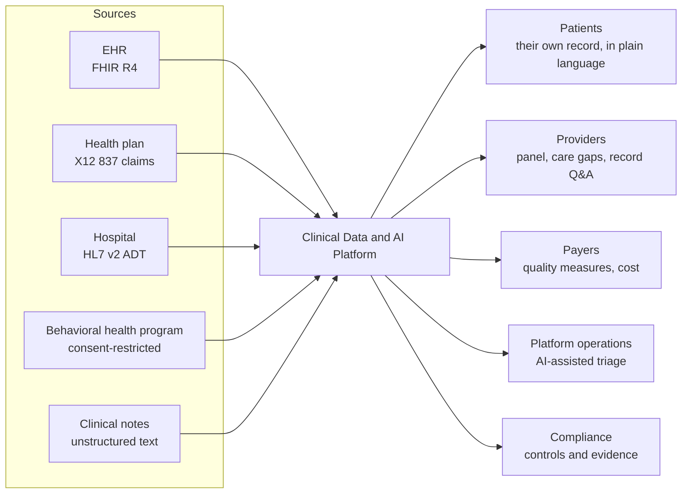
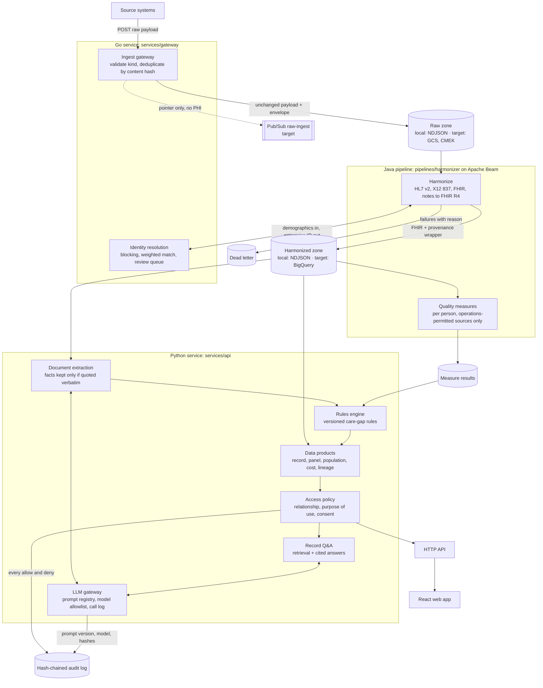
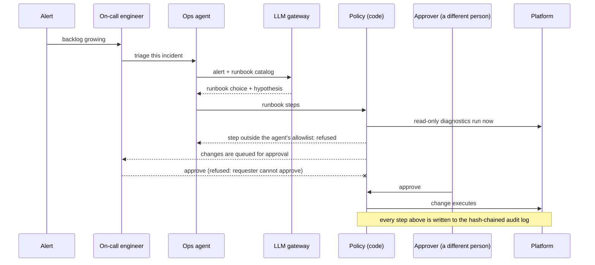
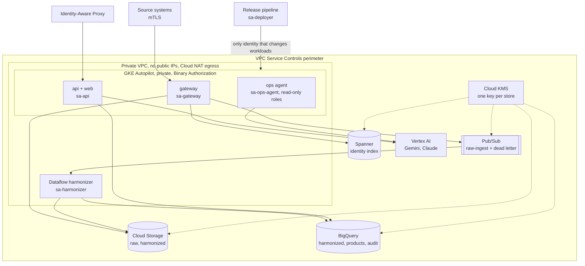

# Architecture

Diagrams are Mermaid, kept next to the code, so engineers and AI agents read and change the same
source. "Built" means it runs in this repository today. "Target" means it is designed and, where
noted, provisioned by Terraform, but the adapter that uses it is not written yet. The README lists
every gap in one place.

## 1. Who uses it

## 2. How data moves

Three properties hold at every arrow:

- **Replayable.** The raw payload is stored unchanged before anything interprets it. When
  conversion logic changes, the harmonized zone can be rebuilt from raw.
- **Traceable.** Every harmonized record carries the ingest ID and hash of the payload it came
  from and the pipeline version that produced it. The web app shows this chain on any record.
- **Idempotent.** Ingest IDs derive from source and content; identity resolution returns the
  same enterprise ID for the same record; loads replace by key. Retrying any stage is safe.

## 3. AI-assisted operations

The model chooses and explains. Code decides what runs. See
[ADR 0006](adr/0006-ai-operations-agent.md).

## 4. Deployment on Google Cloud (target, provisioned by `infra/terraform`)

One project per environment. Each workload runs as its own service account through Workload
Identity, with no key files. The ops agent's account can read metrics and logs and call Vertex AI;
it holds no role that can change anything.

## 5. Decisions

| # | Decision | Record |
|---|---|---|
| 1 | Data rights are enforced at read time from one source registry | [ADR 0001](adr/0001-data-rights-and-isolation.md) |
| 2 | Identity resolution prefers a missed link over a false merge | [ADR 0002](adr/0002-identity-resolution.md) |
| 3 | Raw is landed unchanged; harmonized FHIR is stored as JSON with a provenance wrapper | [ADR 0003](adr/0003-raw-landing-and-fhir-storage.md) |
| 4 | Quality measures are plain Java now, CQL later | [ADR 0004](adr/0004-quality-measures.md) |
| 5 | One governed path to every model; outputs must be grounded | [ADR 0005](adr/0005-llm-governance.md) |
| 6 | The ops agent proposes; code and people dispose | [ADR 0006](adr/0006-ai-operations-agent.md) |
